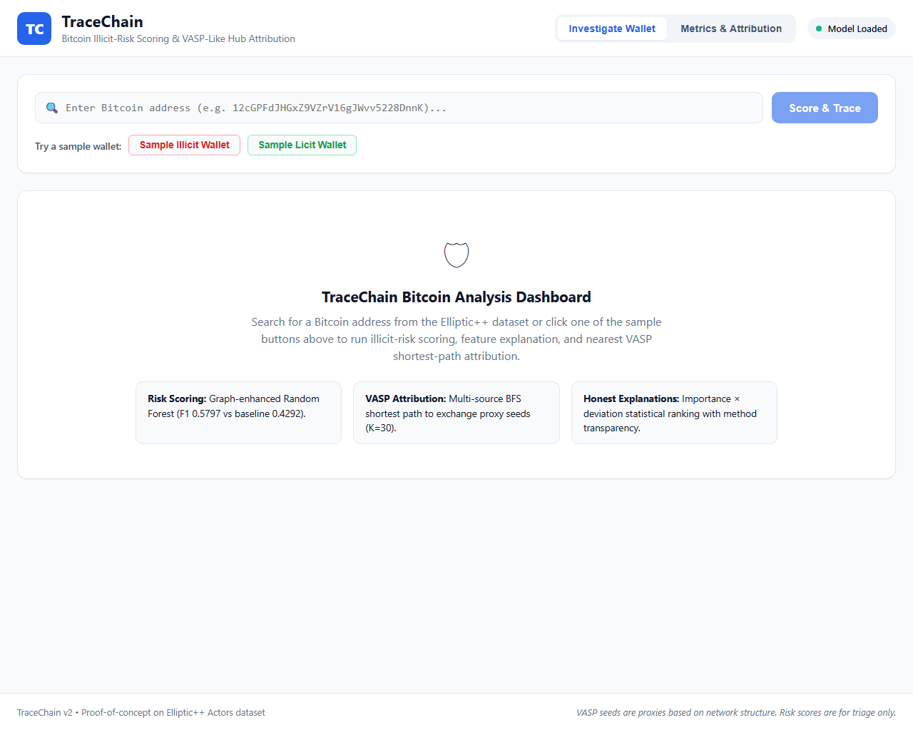
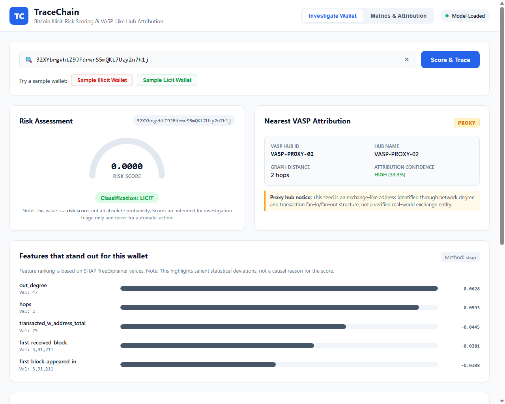

# TraceChain

Bitcoin wallet illicit-risk scoring and nearest VASP-like hub attribution.

---

## Honest Scope

- Public data has no real exchange labels. Elliptic++ labels addresses only as illicit, licit, or unknown.
- "VASP" seeds are proxies: addresses with exchange-like structure (very high degree, high fan-in and fan-out, long activity). The system also supports an optional registry file of real VASP addresses. If present, the registry replaces the proxies.
- The output is "nearest likely VASP-like hub", not an identity. Risk scores are for triage only, never for automatic action.
- Proof of concept on Bitcoin only (Elliptic++ Actors dataset).
- The UI shows whether a seed is a proxy or from the registry.

---

## Dataset

Elliptic++ Actors dataset (Bitcoin address-level features and transaction graph).

Source: https://github.com/git-disl/EllipticPlusPlus

Download from Google Drive (linked in the repo above). Expected files in `data/raw/`:

```
data/raw/
  wallets_classes.csv
  wallets_features.csv
  AddrAddr_edgelist.csv
```

- Total addresses: 822,942 across all three files.
- Directed edge rows in `AddrAddr_edgelist.csv`: 2,868,964 (including 45,981 self-loops).
- Built graph: 822,942 nodes and 2,784,344 directed edges.
- TODO: DATA_NOTES.md records 2,868,964 raw rows in AddrAddr_edgelist.csv but does not state why the built sparse adjacency graph contains 2,784,344 directed edges (investigate multi-edge consolidation during sparse matrix construction).

---

## Results

All figures come directly from `reports/metrics.json` and `reports/attribution_stats.json`.

### Classification

Threshold: 0.5 for the illicit class.

#### All Test Set (Time steps 35 to 49; 97,756 rows; 5,023 illicit, 92,733 licit)

| Model | Features | Precision | Recall | F1 | PR-AUC |
|---|---|---|---|---|---|
| Baseline RF | 55 | 0.5488 | 0.3524 | 0.4292 | 0.3992 |
| Graph-enhanced RF | 60 | 0.8129 | 0.4505 | 0.5797 | 0.6052 |

Graph features added: `in_degree`, `out_degree`, `pagerank`, `mean_neighbor_degree`, `hops` (to nearest VASP-like seed).

#### Cold Test Subset (Test addresses never seen in training period; 94,199 rows; 4,947 illicit, 89,252 licit)

| Model | Features | Precision | Recall | F1 | PR-AUC |
|---|---|---|---|---|---|
| Baseline RF | 55 | 0.5386 | 0.3424 | 0.4187 | 0.3865 |
| Graph-enhanced RF | 60 | 0.8085 | 0.4421 | 0.5716 | 0.5970 |

### Attribution (K=30 proxy seeds, 822,942 addresses)

| Metric | Value |
|---|---|
| Reachable addresses | 822,935 (100.0%) |
| Unattributed addresses | 7 |
| Reachable within 2 hops | 126,431 (15.36%) |
| Reachable within 4 hops | 576,785 (70.09%) |
| Reachable within 6 hops | 738,666 (89.76%) |
| Median hops (illicit) | 4.0 |
| Median hops (licit) | 3.0 |

### Explanation Method

- Python version in use: **3.12.10**
- Active explanation method: On this machine and environment, the API returns `"explanation_method": "shap"` computed via SHAP TreeExplainer.
- Fallback: If SHAP computation takes longer than 2.0 seconds or encounters an error, the system falls back to `"importance_x_deviation"`. The active method is always explicitly returned in the `explanation_method` field of `/api/score/{address}`.

---

## Screenshots

### 1. Search page (welcome state)


### 2. Illicit address result
Address `3LAr1LEZra3sCW15Z2s6pHN4WSoTWfkWYU`, risk score 0.9982.


### 3. Licit address result
Address `32XYbrgvhtZ9JFdrwrS5mQKL7Uzy2n7h1j`, risk score 0.0.



### 4. Fund-flow graph
Transaction subgraph for the illicit address.


### 5. Metrics tab
Live model metrics and attribution stats from the API.


---

## Quick Start

### Requirements

- Python 3.10 or newer (tested on Python 3.12.10)
- Node.js 18 or newer
- Raw data files in `data/raw/` (`wallets_classes.csv`, `wallets_features.csv`, `AddrAddr_edgelist.csv`)

### Setup

```bash
git clone https://github.com/Avaneesh008/tracechain.git
cd tracechain

# Python environment
python -m venv .venv
# Windows:
.venv\Scripts\python.exe -m pip install -r requirements.txt
# Linux / macOS:
.venv/bin/pip install -r requirements.txt
```

### Run the pipeline

Execute the scripts in `scripts/` in sequence:

1. **Inspect dataset**:
   ```bash
   python scripts/00_inspect_data.py
   ```
   Inspects `data/raw/`, checks row counts, headers, and column spellings, and writes `DATA_NOTES.md`.

2. **Prepare data and extract graph features**:
   ```bash
   python scripts/01_prepare.py
   ```
   Loads and cleans raw files, creates address-to-index mapping (`artifacts/address_to_idx.joblib`, `artifacts/idx_to_address.joblib`), builds sparse directed adjacency matrix (`artifacts/address_graph.npz`), computes graph features (`artifacts/graph_features.parquet`), performs temporal split with leakage analysis (`artifacts/train.parquet`, `artifacts/test.parquet`, `artifacts/cold_test.parquet`), and saves `artifacts/prepared_metadata.json`.

3. **Build VASP attribution index**:
   ```bash
   python scripts/02_build_vasp_index.py
   ```
   Selects top K=30 proxy seeds (or loads `data/registry/vasp_registry.csv` if present), runs multi-source BFS on the undirected graph, benchmarks path reconstruction, and produces `artifacts/vasp_index.parquet`, `artifacts/vasp_seeds.parquet`, and `reports/attribution_stats.json`.

4. **Train models and evaluate**:
   ```bash
   python scripts/03_train.py
   ```
   Trains baseline (55 features) and graph-enhanced (60 features) Random Forest classifiers, evaluates performance on test and cold-test sets, saves models (`artifacts/model.joblib`), feature lists, and feature statistics (`artifacts/feature_stats.json`), generates plots in `reports/figures/`, outputs `reports/metrics.json`, and triggers `scripts/04_make_results.py`.

5. **Generate markdown result tables**:
   ```bash
   python scripts/04_make_results.py
   ```
   Reads `reports/metrics.json`, `reports/attribution_stats.json`, and `artifacts/prepared_metadata.json` to generate formatted result tables in `reports/RESULTS.md`.

### Run tests

All tests use pytest and synthetic/real fixtures:

```bash
python -m pytest tests/ -v
```

All 28 tests in `tests/` pass with `httpx==0.28.1` as specified in `requirements.txt`. The `StarletteDeprecationWarning` regarding `httpx` and `httpx2` emitted by `fastapi.testclient` is an upstream Starlette deprecation notice; `httpx` is the real pinned package.

### Start the API

```bash
# Windows:
.venv\Scripts\uvicorn.exe api.main:app --port 8000
# Linux / macOS:
.venv/bin/uvicorn api.main:app --port 8000
```

Startup takes approximately 30-40 seconds on first load to index the 822K node graph.

Health check: `GET http://127.0.0.1:8000/api/health`

Expected response:
```json
{"status": "ok", "model_loaded": true, "graph_nodes": 822942}
```

### Start the web dashboard

```bash
cd web
npm install
npm run dev
```

Open `http://localhost:5173` in a browser.

The dashboard connects to `http://127.0.0.1:8000` by default. Set `VITE_API_URL` to override, or `VITE_USE_MOCK=true` to test against mock data.

---

## API Endpoints

All endpoints are HTTP `GET` routes defined in `api/main.py`:

| Method | Path | Parameters | Description |
|---|---|---|---|
| GET | `/api/health` | None | Returns API status, model loaded flag, and graph node count |
| GET | `/api/wallets/sample` | Query: `label` (`illicit` or `licit`, default `illicit`), `n` (1-50, default 5) | Returns demo test-period addresses with known labels |
| GET | `/api/score/{address}` | Path: `address` (Bitcoin address string) | Returns risk score, risk label, nearest VASP attribution, top 5 features, and explanation method |
| GET | `/api/trace/{address}` | Path: `address` (Bitcoin address string) | Returns shortest path to nearest VASP seed and neighbor subgraph nodes and directed edges |
| GET | `/api/metrics` | None | Returns contents of `reports/metrics.json` and `reports/attribution_stats.json` |

### Verified Endpoint Calls & Responses

#### 1. GET `/api/health`
```bash
curl -s http://127.0.0.1:8000/api/health
```
```json
{"status":"ok","model_loaded":true,"graph_nodes":822942}
```

#### 2. GET `/api/wallets/sample?label=illicit&n=2`
```bash
curl -s "http://127.0.0.1:8000/api/wallets/sample?label=illicit&n=2"
```
```json
{
  "wallets": [
    {"address": "3LAr1LEZra3sCW15Z2s6pHN4WSoTWfkWYU", "label": "illicit", "time_step": 40},
    {"address": "12k7kXAo7JjcHTnoPxpYsYQRVDAZaM4Jfq", "label": "illicit", "time_step": 40}
  ]
}
```

#### 3. GET `/api/score/3LAr1LEZra3sCW15Z2s6pHN4WSoTWfkWYU`
```bash
curl -s "http://127.0.0.1:8000/api/score/3LAr1LEZra3sCW15Z2s6pHN4WSoTWfkWYU"
```
```json
{
  "address": "3LAr1LEZra3sCW15Z2s6pHN4WSoTWfkWYU",
  "time_step": 40,
  "risk_score": 0.9982,
  "risk_label": "illicit",
  "nearest_vasp": {
    "id": "VASP-PROXY-16",
    "name": "VASP-PROXY-16",
    "kind": "proxy",
    "hops": 4,
    "confidence": "medium",
    "confidence_score": 0.2
  },
  "top_features": [
    {"name": "mean_neighbor_degree", "value": 3.7143, "contribution": 0.0661},
    {"name": "total_txs", "value": 11.0, "contribution": 0.0519},
    {"name": "fees_as_share_total", "value": 0.0011, "contribution": 0.0476},
    {"name": "fees_min", "value": 0.0001, "contribution": 0.044},
    {"name": "last_block_appeared_in", "value": 469827.0, "contribution": 0.0358}
  ],
  "explanation_method": "shap"
}
```

#### 4. GET `/api/trace/3LAr1LEZra3sCW15Z2s6pHN4WSoTWfkWYU`
```bash
curl -s "http://127.0.0.1:8000/api/trace/3LAr1LEZra3sCW15Z2s6pHN4WSoTWfkWYU"
```
```json
{
  "path": [
    "3LAr1LEZra3sCW15Z2s6pHN4WSoTWfkWYU",
    "179p4ecZMRoF44Thq74Uv5jLBwrZdbYsmc",
    "1FCPM4W7k1yyRPeXDJP5kHR5LuAWS7VpiH",
    "1CPAKGFR67V3jDBd2BHdWGJo7RLsfWPUSK",
    "1MFXYK1XucKFfhPhW9HDHD3vsM9BKey4qm"
  ],
  "nodes": [
    {"id": "3LAr1LEZra3sCW15Z2s6pHN4WSoTWfkWYU", "kind": "wallet"},
    {"id": "179p4ecZMRoF44Thq74Uv5jLBwrZdbYsmc", "kind": "path"},
    {"id": "1FCPM4W7k1yyRPeXDJP5kHR5LuAWS7VpiH", "kind": "path"},
    {"id": "1CPAKGFR67V3jDBd2BHdWGJo7RLsfWPUSK", "kind": "path"},
    {"id": "1MFXYK1XucKFfhPhW9HDHD3vsM9BKey4qm", "kind": "vasp"},
    {"id": "15XskUXiWwRC7UnUAkkP31muXkWq5GvJnR", "kind": "neighbor"}
  ],
  "edges": [
    {"source": "15XskUXiWwRC7UnUAkkP31muXkWq5GvJnR", "target": "3LAr1LEZra3sCW15Z2s6pHN4WSoTWfkWYU"},
    {"source": "179p4ecZMRoF44Thq74Uv5jLBwrZdbYsmc", "target": "3LAr1LEZra3sCW15Z2s6pHN4WSoTWfkWYU"},
    {"source": "1FCPM4W7k1yyRPeXDJP5kHR5LuAWS7VpiH", "target": "179p4ecZMRoF44Thq74Uv5jLBwrZdbYsmc"},
    {"source": "1CPAKGFR67V3jDBd2BHdWGJo7RLsfWPUSK", "target": "1FCPM4W7k1yyRPeXDJP5kHR5LuAWS7VpiH"},
    {"source": "1MFXYK1XucKFfhPhW9HDHD3vsM9BKey4qm", "target": "1CPAKGFR67V3jDBd2BHdWGJo7RLsfWPUSK"}
  ]
}
```

#### 5. GET `/api/metrics`
```bash
curl -s "http://127.0.0.1:8000/api/metrics"
```
Returns a combined JSON object containing `baseline` metrics, `graph_enhanced` metrics, and `attribution_stats`.

---

## Project Structure

```
tracechain/
  api/            FastAPI application (main.py)
  src/tracechain/ Python library (data, features, vasp, model, explain, service)
  scripts/        Pipeline scripts (00_inspect_data.py through 04_make_results.py)
  tests/          pytest test suite (28 tests)
  web/            Vite + React dashboard
  data/           raw/ (not committed), registry/ (optional)
  artifacts/      model files, index, and graphs (not committed)
  reports/        metrics.json, attribution_stats.json, figures/, screenshots/
```

---

## Team

| Name | Role |
|---|---|
| Avaneesh | API, VASP index, pipeline coordination |
| Sriraghava | Data preparation, feature engineering, model training |
| Balu | Web dashboard, screenshots, documentation |

---

## Disclaimers

Risk scores are produced by a machine learning model trained on the Elliptic++ dataset. They are for triage only, never for automatic action. The dataset has no verified exchange labels. VASP seeds are structural proxies, not confirmed exchange identities. Do not use this system to make accusations about real Bitcoin addresses.
