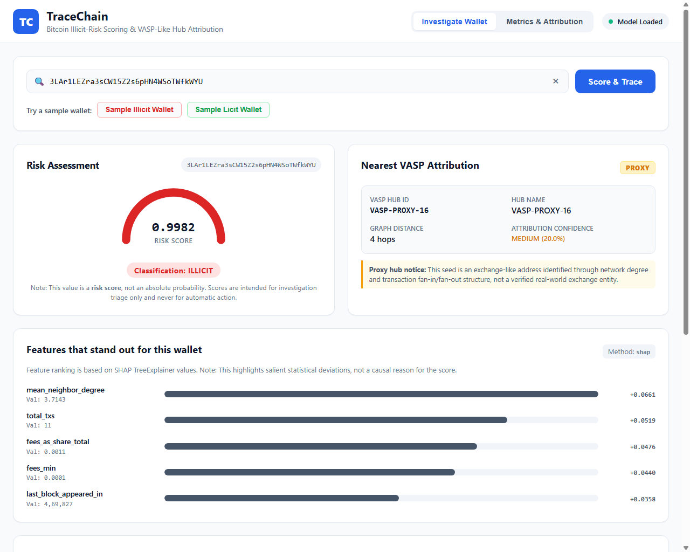
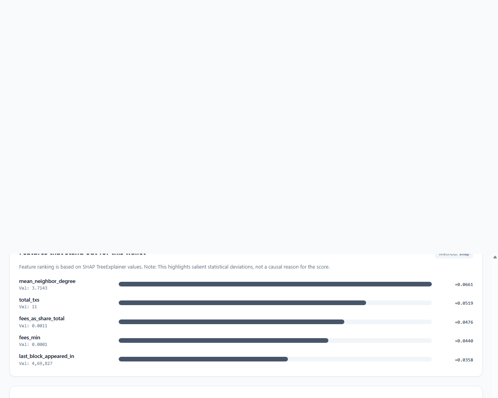
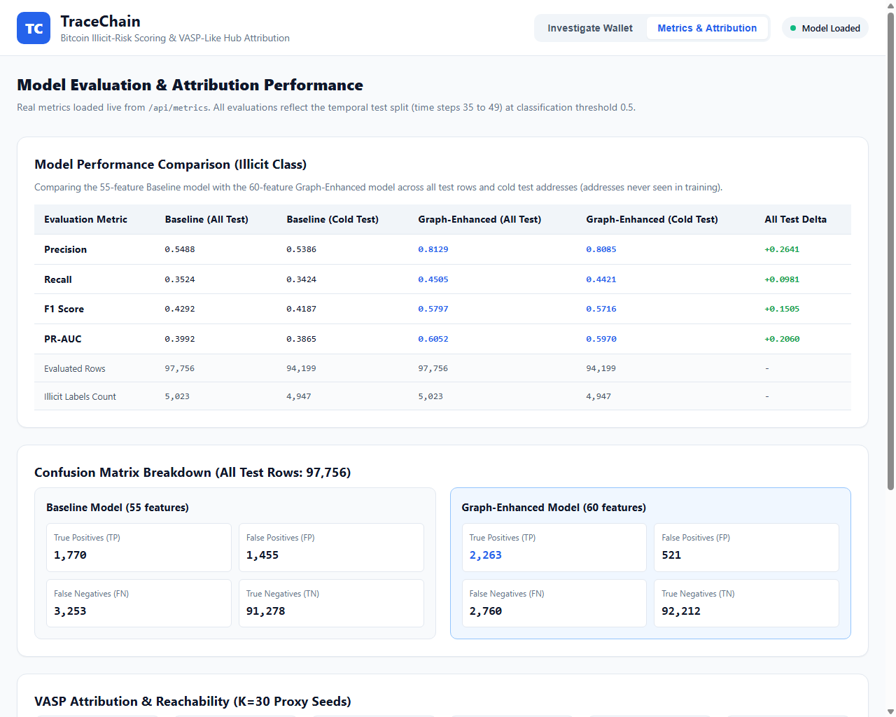

# TraceChain

Bitcoin wallet illicit-risk scoring and nearest VASP-like hub attribution.

---

## Honest Scope

- Public data has no real exchange labels. Elliptic++ labels addresses only as illicit, licit, or unknown.
- "VASP" seeds are proxies: addresses with exchange-like structure (very high degree, high fan-in and fan-out, long activity). The system also supports an optional registry file of real VASP addresses. If present, the registry replaces the proxies.
- The output is "nearest likely VASP-like hub", not an identity. Risk scores are for triage only, never for automatic action.
- Proof of concept on Bitcoin only (Elliptic++ Actors dataset).
- The UI shows whether a seed is a proxy or from the registry.

---

## Dataset

Elliptic++ Actors dataset (Bitcoin address-level features and transaction graph).

Source: https://github.com/git-disl/EllipticPlusPlus

Download from Google Drive (see the repo above). Place files in `data/raw/`:

```
data/raw/
  wallets_features.csv
  AddrAddr_edgelist.csv
  elliptic_txs_classes.csv   (optional, for label join)
```

Graph: 822,942 nodes, 2,784,344 directed edges.

---

## Results

All numbers come from `reports/metrics.json` and `reports/attribution_stats.json`.

### Classification (test set, 97,756 addresses, 5,023 illicit)

| Model | Features | F1 | PR-AUC |
|---|---|---|---|
| Baseline RF | 55 | 0.4292 | 0.3992 |
| Graph-enhanced RF | 60 | 0.5797 | 0.6052 |

Graph features added: in-degree, out-degree, PageRank, mean neighbor degree, hops to nearest VASP-like seed.

### Attribution (k=30 proxy seeds, 822,942 addresses)

| Metric | Value |
|---|---|
| Reachable addresses | 822,935 (99.999%) |
| Unattributed | 7 |
| Reachable within 4 hops | 576,785 (70.1%) |
| Reachable within 6 hops | 738,666 (89.8%) |
| Median hops (illicit) | 4.0 |
| Median hops (licit) | 3.0 |

Explanation: SHAP values from the trained Random Forest. If SHAP is unavailable at runtime the system falls back to importance x deviation. The API response always includes the `explanation_method` field.

---

## Screenshots

### 1. Search page (welcome state)


### 2. Illicit address result
Address `3LAr1LEZra3sCW15Z2s6pHN4WSoTWfkWYU`, risk score 0.9982.



### 3. Licit address result
Address `32XYbrgvhtZ9JFdrwrS5mQKL7Uzy2n7h1j`, risk score 0.0.


### 4. Fund-flow graph
Transaction subgraph for the illicit address.



### 5. Metrics tab
Live model metrics and attribution stats from the API.



---

## Quick Start

### Requirements

- Python 3.10 or newer
- Node.js 18 or newer
- Data files in `data/raw/` (see Dataset section)

### Setup

```bash
git clone https://github.com/Avaneesh008/tracechain.git
cd tracechain

# Python environment
python -m venv .venv
# Windows:
.venv\Scripts\python.exe -m pip install -r requirements.txt
# Linux / macOS:
.venv/bin/pip install -r requirements.txt
```

### Run the pipeline

```bash
# 00 - build address feature table
python scripts/00_build_wallet_features.py

# 01 - build address graph
python scripts/01_build_address_graph.py

# 02 - build VASP attribution index
python scripts/02_build_vasp_index.py

# 03 - train models
python scripts/03_train_model.py

# 04 - explain (SHAP values)
python scripts/04_explain.py
```

Outputs land in `artifacts/` and `reports/`.

### Start the API

```bash
# Windows:
.venv\Scripts\uvicorn.exe api.main:app --port 8000
# Linux / macOS:
.venv/bin/uvicorn api.main:app --port 8000
```

The first startup takes about 30-40 seconds to load the graph (822K nodes).

Health check: `GET http://127.0.0.1:8000/api/health`

Expected response:
```json
{"status": "ok", "model_loaded": true, "graph_nodes": 822942}
```

### Start the web dashboard

```bash
cd web
npm install
npm run dev
```

Open `http://localhost:5173` in a browser.

The dashboard connects to the API at `http://127.0.0.1:8000` by default. Set the `VITE_API_URL` environment variable to override.

To use mock data without a running API, set `VITE_USE_MOCK=true`.

### Run tests

```bash
python -m pytest tests/ -v --ignore=tests/test_api.py
```

Note: `tests/test_api.py` requires `httpx2` (Starlette compatibility). Run it separately after installing `httpx2`.

---

## API Endpoints

| Method | Path | Description |
|---|---|---|
| GET | `/api/health` | Service health and model status |
| POST | `/api/score` | Risk score and SHAP explanation for one address |
| POST | `/api/trace` | Fund-flow subgraph (nodes and edges) |
| GET | `/api/metrics` | Live model metrics and attribution stats |

### Example: score an address

```bash
curl -X POST http://127.0.0.1:8000/api/score \
  -H "Content-Type: application/json" \
  -d '{"address": "3LAr1LEZra3sCW15Z2s6pHN4WSoTWfkWYU", "time_step": 40}'
```

```json
{
  "risk_score": 0.9982,
  "classification": "illicit",
  "explanation_method": "shap",
  "top_features": ["..."],
  "nearest_vasp": {"seed_id": "VASP-PROXY-10", "kind": "proxy", "hops": 2}
}
```

---

## Project Structure

```
tracechain/
  api/            FastAPI application
  src/tracechain/ Python library (features, graph, model, explain, vasp)
  scripts/        Pipeline scripts (run in order 00-04)
  tests/          pytest test suite
  web/            Vite + React dashboard
  data/           raw/ (not committed), processed/ (not committed)
  artifacts/      model files and index (not committed)
  reports/        metrics.json, attribution_stats.json, figures/, screenshots/
```

---

## Team

| Name | Role |
|---|---|
| Avaneesh | API, VASP index, pipeline coordination |
| Sriraghava | Data preparation, feature engineering, model training |
| Balu | Web dashboard, screenshots, documentation |

---

## Disclaimers

Risk scores are produced by a machine learning model trained on the Elliptic++ dataset. They are for triage only, never for automatic action. The dataset has no verified exchange labels. VASP seeds are structural proxies, not confirmed exchange identities. Do not use this system to make accusations about real Bitcoin addresses.
